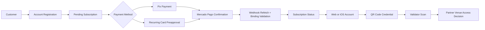
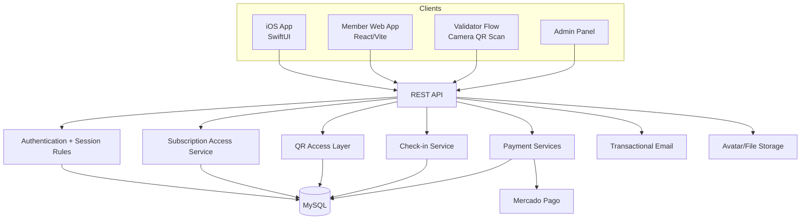
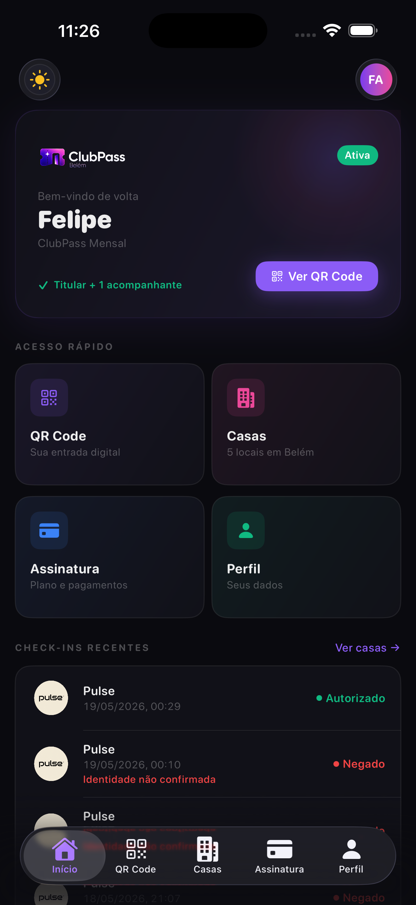
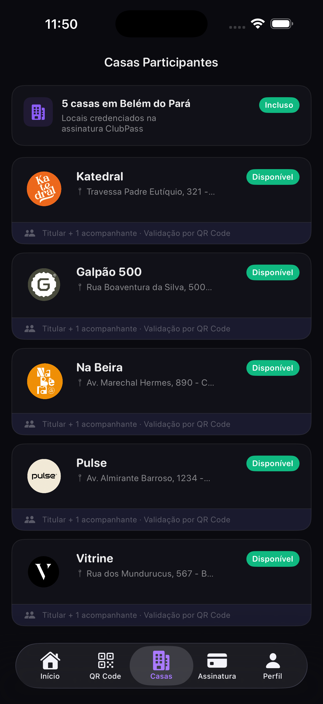
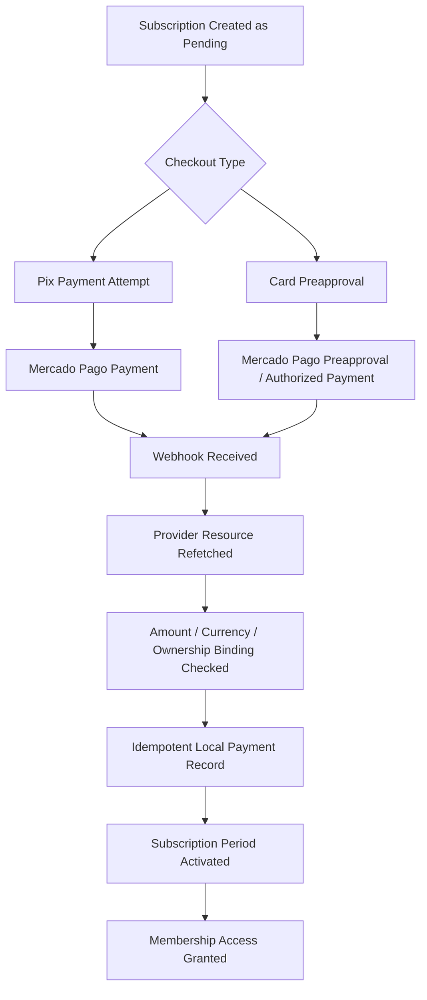
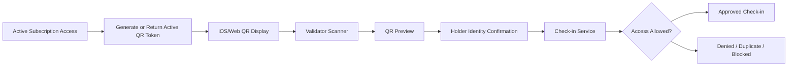

# Club Pass Belém

### Subscription & QR Access Platform

Subscription platform connecting members to partner venues through Mercado Pago payments, digital membership management and QR Code-based access validation.

The product includes a PHP REST backend, a React/Vite web and admin application, validator flows, MySQL persistence and a native SwiftUI iOS application.

> Source code remains private. This repository is a public technical case study with sanitized screenshots and no secrets, tokens, credentials or sensitive infrastructure details.

## Product Flow

The access flow is not just "a subscription system". It connects registration, payment, subscription state, member identity, QR Code generation, validator authorization and partner venue access rules.

## System Architecture

## Mobile Application

The iOS app is the main public evidence that the product extends beyond web/backend delivery.

Confirmed stack and implementation:

- **Language/UI:** Swift and SwiftUI.
- **Architecture:** MVVM-style structure with `Views`, `ViewModels`, `Models`, `Services`, `Core` and feature folders.
- **Minimum target:** iOS 17.
- **Networking:** `URLSession`, typed API endpoints and Codable DTOs.
- **API communication:** Bearer token requests against the backend REST API.
- **Authentication/session:** login flow, token persisted in Keychain, session restoration and logout on unauthorized responses.
- **Navigation:** role-based root routing for subscriber, validator and admin flows; subscriber `TabView`; admin iPad `NavigationSplitView`.
- **QR Code:** subscriber wallet renders the QR credential with Core Image only when backend access state allows it.
- **Validation:** validator scanner uses AVFoundation camera scanning, preview, identity confirmation and backend check-in confirmation.
- **Environment configuration:** local/staging/production API environments through build configuration files.
- **Build:** Xcode project, release/debug configuration and automated iOS validation in CI.
- **Publication:** App Store screenshot and operation material exists, but public App Store/TestFlight publication was not treated as proven from the code alone.
- **Push notifications:** not confirmed as implemented.

### iOS Screenshots

Sanitized iPhone screenshots from the product repository:

  
  
  
  
  

## Backend Engineering

Confirmed backend capabilities:

- Custom PHP 8.2 REST backend using PSR-4 autoloading.
- MySQL schema with users, venues, plans, subscriptions, payments, check-ins, validator users, QR codes, access grants, identities, admin/audit and email-related tables.
- JWT authentication with token versioning for logout and server-side revocation.
- Separate member, validator and admin surfaces.
- Email verification and password reset flows.
- Subscription status and access state centralized in a subscription access service.
- Member QR Code creation, rotation, expiration and access-state checks.
- Validator QR preview and confirmed check-in flow.
- Partner venue access control through authorized validator venues and active venue status.
- Check-in rules for access window, max access count and venue reuse policy.
- Admin APIs for users, venues, subscriptions, check-ins, QR codes, validators, payment settings, payment recipients, split rules, email settings and audit/security logs.
- Avatar/file handling through storage services.

## Payment Lifecycle

Important implementation details:

- Pix payment creation uses local attempt records and Mercado Pago idempotency keys.
- Pending Pix does not grant member access.
- Recurring card subscriptions are represented through Mercado Pago preapproval flows.
- A preapproval alone does not activate paid access; approved payment confirmation is required.
- Webhooks are not trusted blindly: the backend refetches the provider resource before applying state changes.
- Duplicate webhook/payment application is controlled through local event/payment records and uniqueness constraints.
- Payment split/marketplace support exists through Mercado Pago recipient connection and application fee handling.

## QR Access Lifecycle

QR access is stateful. The backend decides whether the member can display/use the credential based on subscription status, payment status, account state and check-in rules.

## Engineering Challenges

Real challenges visible in the implementation:

- Keeping subscription access synchronized with external payment state.
- Handling Pix attempts without accidentally granting access while payment is still pending.
- Separating recurring preapproval state from actual paid activation.
- Making webhook processing idempotent and provider-verified.
- Preventing QR access when the account or subscription is blocked.
- Rotating and expiring QR tokens without breaking active members.
- Validating access by venue, validator authorization and access window.
- Avoiding duplicate check-ins through backend state and database constraints.
- Supporting mobile, web, admin and validator clients against the same API.
- Preparing production deployment with Docker, Nginx, CI, Cloud Build/Cloud Run material, deploy scripts and rollback/readiness checks.

## Technical Evidence Matrix

Verified against the private source tree on 2026-08-27.

| Capability | Status | Evidence in implementation |
|---|---:|---|
| Authentication | Confirmed | Auth controllers/services, JWT service, auth middleware, token version revocation |
| Users | Confirmed | User tables, member profile APIs, account deletion, identities |
| Subscriptions | Confirmed | Subscription controller/service, plans, subscription status and access service |
| Payments | Confirmed | Mercado Pago service, subscription payments, Pix attempts, card preapproval |
| Recurrence | Confirmed | Mercado Pago preapproval and recurring card subscription paths |
| Subscription status | Confirmed | Centralized subscription access evaluation |
| QR Code | Confirmed | Subscriber QR code table and QR service |
| QR Code generation | Confirmed | `/api/me/qrcode` creates or returns an active member QR token |
| QR Code validation | Confirmed | Validator preview and check-in confirmation endpoints |
| Access control | Confirmed | Subscription access service, validator venue authorization, account blocking |
| Partner venues | Confirmed | Venue models, APIs and validator/venue assignment |
| Usage rules | Confirmed | Access window, max access count, multi-venue policy and duplicate prevention |
| Backend | Confirmed | PHP REST backend with service/controller/model structure |
| APIs | Confirmed | Member, validator, admin, subscription, payment and webhook routes |
| Database | Confirmed | MySQL migrations for product, payment, QR, check-in and admin domains |
| Admin panel | Confirmed | Admin routes and React admin pages for operations/configuration |
| iOS application | Confirmed | Native SwiftUI app with Xcode project and iOS source tree |
| Mobile/backend integration | Confirmed | iOS API client, endpoint enum, bearer authentication and session manager |
| Notifications | Partial | Transactional email exists; push notifications were not confirmed |
| Webhooks | Confirmed | Mercado Pago webhook controller and provider refetch flow |
| Infrastructure | Confirmed | Dockerfile, docker-compose, Nginx/PHP image, Cloud Build material and CI workflow |
| Deploy/production workflow | Confirmed | Staging/production deploy scripts, readiness checks and production runbook material |

## What Is Not Claimed

- No claim that iOS is my primary specialization.
- No claim that push notifications are implemented.
- No claim that App Store/TestFlight publication is proven from this public case study.
- No publication of secrets, provider tokens, production project IDs or sensitive infrastructure configuration.

## Role Demonstrated

This case demonstrates full product engineering across backend, frontend, mobile, payments, QR access, database modeling, admin operations, deployment preparation and production-oriented safeguards.
