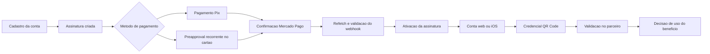
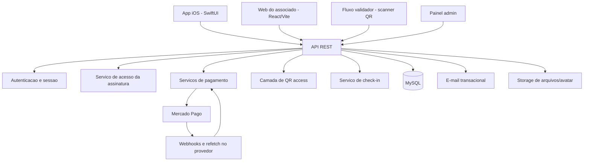
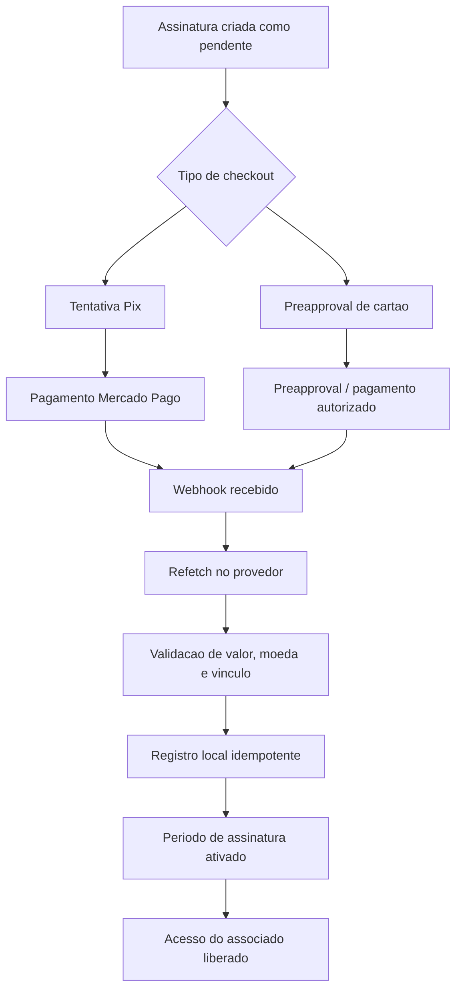
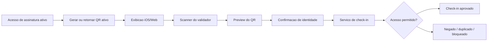
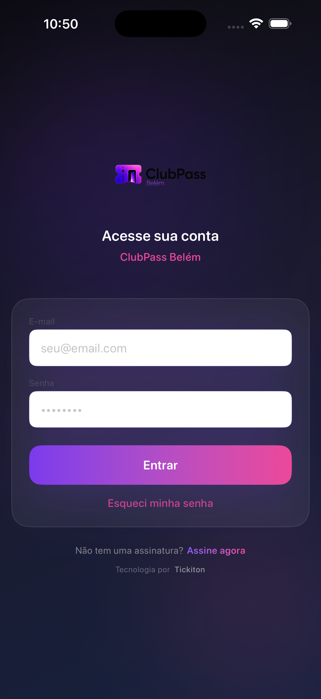
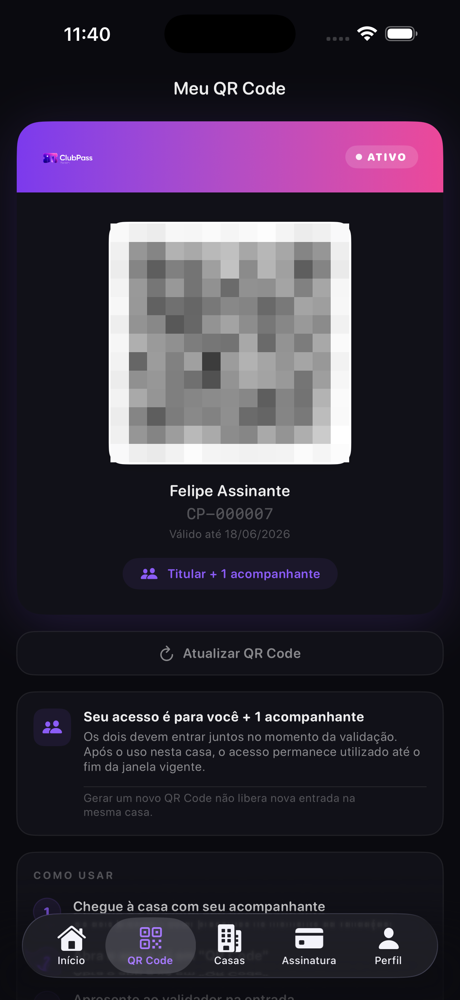
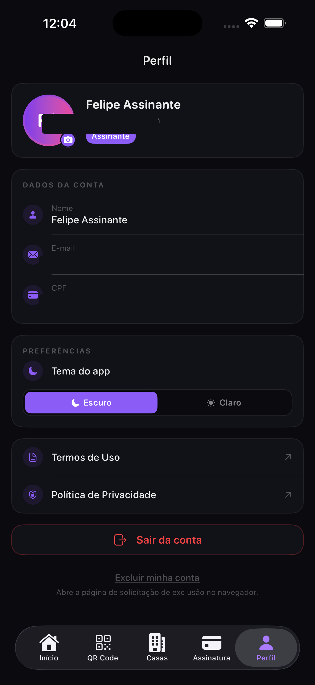

# Club Pass Belém

### Assinaturas / Acesso por QR Code / Pagamentos / iOS

App iOS na [App Store](https://apps.apple.com/br/app/clubpass-bel%C3%A9m/id6787500885)

## Visão Geral

Club Pass Belém é uma plataforma de assinatura e acesso por QR Code que conecta associados a estabelecimentos parceiros por meio de pagamentos Mercado Pago, gestão digital de assinatura e validação de uso do benefício.

O produto inclui backend REST em PHP, interfaces web/admin com React/Vite, fluxos de validação, persistência MySQL e aplicativo iOS nativo com SwiftUI.

Este repositório é um estudo de caso técnico público com screenshots sanitizados. Código-fonte privado, credenciais, URLs de produção, tokens de provedor, dados de clientes e detalhes sensíveis de infraestrutura não são publicados.

## Problema

O produto precisava conectar pagamento recorrente de assinatura com uso real de benefício em estabelecimentos parceiros.

Isso significa que o sistema não termina em "usuário assinou". Ele precisa ativar o acesso somente após confirmação do pagamento, expor identidade do associado com segurança, gerar credenciais em QR Code, validar acesso no estabelecimento, aplicar regras de uso e atender clientes web, admin, validador e iOS usando o mesmo backend.

## Solução

O código privado implementa um modelo de assinatura e acesso controlado pelo backend.

O estado do pagamento é confirmado por fluxos Mercado Pago e webhooks, o acesso da assinatura é avaliado por serviços backend, e a exibição/validação do QR Code depende de regras de conta, assinatura, estabelecimento e check-in.

O app iOS é um cliente real do produto para associados e validadores, publicado na App Store e ligado à mesma API da web.

## Fluxo do Produto

## Arquitetura do Sistema

## Stack Técnica

- Backend: PHP 8.2, aplicação REST customizada com estrutura de services/controllers/models.
- Frontend: React, Vite e interfaces web para associado/admin.
- Mobile: Swift, SwiftUI, iOS 17 e organização em estilo MVVM.
- Banco de dados: MySQL.
- Pagamentos: Mercado Pago Pix, preapproval com cartão, recorrência, webhooks e suporte a split/recipient.
- QR/acesso: geração de credenciais QR, scanner validador, preview e check-in confirmado.
- Infraestrutura: Docker, imagem Nginx/PHP, docker-compose, CI, Cloud Build/Cloud Run.

## Aplicativo Mobile

O app está publicado na App Store, hoje na versão 1.1, e atende associados, validadores e administradores.

Detalhes confirmados:

- Linguagem/UI: Swift e SwiftUI.
- Arquitetura: organização em estilo MVVM com `Views`, `ViewModels`, `Models`, `Services`, `Core` e pastas por feature.
- Networking: `URLSession`, endpoints tipados e DTOs Codable.
- Autenticação/sessão: requisições com bearer token, persistência em Keychain, restauração de sessão e logout em respostas não autorizadas.
- Navegação: roteamento raiz por perfil para associado, validador e admin; `TabView` para associado; `NavigationSplitView` para admin em iPad.
- QR Code: carteira do associado renderiza a credencial com Core Image somente quando o backend permite acesso.
- Validação: scanner do validador usa AVFoundation, preview, confirmação de identidade e confirmação de check-in no backend.
- Configuração de ambiente: ambientes local, staging e produção por arquivos de build.
- Build: projeto Xcode com configuração debug/release e validação iOS automatizada em CI.

## Engenharia Backend

Capacidades confirmadas no backend:

- Autenticação com JWT/token versioning para logout e revogação.
- Usuários, perfis de associado, estado da conta, verificação de e-mail e recuperação de senha.
- Planos, assinaturas, status de assinatura e avaliação de estado de acesso.
- Tentativas de pagamento Pix e fluxos recorrentes com preapproval de cartão.
- Webhooks Mercado Pago com refetch no provedor antes de alterar estado local.
- Criação, rotação, expiração e checagem de acesso do QR Code do associado.
- Preview de QR pelo validador e check-in confirmado.
- Controle de acesso por estabelecimento, status do parceiro e autorização do validador.
- APIs admin para usuários, estabelecimentos, assinaturas, pagamentos, QR Codes, validadores, configuração de pagamento, split, e-mail e logs de auditoria/segurança.

## Dados / Banco de Dados

O schema MySQL inclui usuários, estabelecimentos, planos, assinaturas, pagamentos de assinatura, tentativas de pagamento, QR Codes, check-ins, validadores, vínculos com estabelecimentos, identidades, registros admin/auditoria e tabelas relacionadas a e-mail.

O QR access é stateful. O backend decide se o associado pode exibir ou usar a credencial com base em pagamento, assinatura, conta, regras do estabelecimento e histórico de check-in.

## Integrações

- Criação de pagamento Pix via Mercado Pago.
- Preapproval de cartão via Mercado Pago para fluxos recorrentes.
- Webhooks Mercado Pago com refetch de recurso e validação de vínculo.
- Suporte a recipient/split Mercado Pago por regras de pagamento e application fee.
- Fluxos de e-mail transacional.
- Integração do app iOS nativo com a API REST.

## Segurança

Detalhes confirmados no código privado:

- Revogação de sessão por JWT/token version.
- Avaliação de acesso da assinatura controlada pelo backend.
- Pagamentos Pix pendentes não liberam acesso de associado.
- Estado de preapproval separado da ativação paga.
- Webhooks verificados por refetch no provedor e validações locais.
- Tratamento idempotente de pagamentos/eventos com registros locais e constraints.
- Tokens QR rotacionam e expiram.
- Autorização por estabelecimento e janela de acesso aplicada no backend.
- Estudo de caso público criado sem histórico Git privado ou credenciais de provedor.

## Ciclo de Pagamento

Pontos importantes:

- Criação de Pix usa registros locais de tentativa e chaves de idempotência Mercado Pago.
- Pix pendente não libera acesso.
- Assinaturas recorrentes com cartão usam fluxos de preapproval Mercado Pago.
- Preapproval sozinho não ativa acesso pago; é necessária confirmação de pagamento aprovado.
- Webhooks não são aceitos cegamente: o backend refaz a consulta no provedor antes de aplicar estado.
- Duplicidade é controlada por registros locais e constraints.
- Split/marketplace existe por conexão de recipient Mercado Pago e application fee.

## Ciclo de Acesso por QR Code

O acesso por QR é stateful. O backend decide se o associado pode exibir/usar a credencial com base em assinatura, pagamento, conta e regras de check-in.

## Desafios de Engenharia

- Sincronizar estado externo de pagamento com acesso local da assinatura.
- Evitar ativação enquanto Pix ainda está pendente.
- Separar preapproval recorrente de ativação paga.
- Processar webhooks de forma idempotente e verificada no provedor.
- Bloquear QR quando conta ou assinatura não permitem acesso.
- Rotacionar e expirar QR sem quebrar associados ativos.
- Validar acesso por estabelecimento, autorização de validador, janela de uso e duplicidade.
- Atender mobile, web, admin e validador pela mesma API.

## Testes e Confiabilidade

O repositório privado contém CI e materiais de validação para backend, web, mobile, readiness de deploy e scripts operacionais.

A confiabilidade também aparece no desenho transacional: refetch no provedor, aplicação idempotente de pagamentos, constraints, avaliação explícita de assinatura e decisões de QR/check-in controladas pelo backend.

## Infraestrutura e Deploy

O repositório privado inclui Docker, docker-compose, imagem Nginx/PHP, Cloud Build, referências Cloud Run, scripts de deploy staging/produção, readiness checks e material de runbook.

Identificadores de projeto, nomes de serviço, URLs de produção e credenciais não são publicados.

## Produção

Existe material de deploy e operação em produção no código privado. Este estudo de caso expõe arquitetura e decisões de engenharia mantendo detalhes operacionais privados.

## Capturas de Tela

Capturas de tela iPhone sanitizadas do repositório do produto:

  
  
  
  
  

## Matriz de Evidências Técnicas

Verificado contra a árvore privada em 2026-08-27.

| Capacidade | Status | Evidência na implementação |
|---|---:|---|
| Autenticação | Confirmado | Controllers/services de auth, JWT service, middleware auth, revogação por token version |
| Usuários | Confirmado | Tabelas de usuário, APIs de perfil, exclusão de conta, identidades |
| Assinaturas | Confirmado | Controller/service de assinatura, planos, status e serviço de acesso |
| Pagamentos | Confirmado | Mercado Pago service, pagamentos de assinatura, tentativas Pix, preapproval de cartão |
| Recorrência | Confirmado | Preapproval Mercado Pago e caminhos de assinatura recorrente com cartão |
| Status de assinatura | Confirmado | Avaliação centralizada de acesso |
| QR Code | Confirmado | Tabela e serviço de QR Code do associado |
| Geração de QR Code | Confirmado | `/api/me/qrcode` cria ou retorna QR ativo do associado |
| Validação de QR Code | Confirmado | Endpoints de preview e confirmação de check-in |
| Controle de acesso | Confirmado | Serviço de assinatura, autorização por estabelecimento, bloqueio de conta |
| Estabelecimentos parceiros | Confirmado | Models/APIs de venue e atribuição de validador |
| Regras de uso | Confirmado | Janela de acesso, limite de uso, política multi-venue e prevenção de duplicidade |
| Backend | Confirmado | Backend REST PHP com estrutura de services/controllers/models |
| APIs | Confirmado | Rotas member, validator, admin, subscription, payment e webhook |
| Banco de dados | Confirmado | Migrations MySQL para produto, pagamento, QR, check-in e admin |
| Painel administrativo | Confirmado | Rotas admin e páginas React para operação/configuração |
| Aplicativo iOS | Confirmado | App SwiftUI nativo com projeto Xcode e árvore de código iOS |
| Integração mobile/backend | Confirmado | API client iOS, enum de endpoints, bearer auth e session manager |
| Notificações | Parcial | E-mail transacional existe; push notifications não foram confirmadas |
| Webhooks | Confirmado | Controller Mercado Pago e fluxo de refetch no provedor |
| Infraestrutura | Confirmado | Dockerfile, docker-compose, imagem Nginx/PHP, Cloud Build e workflow CI |
| Deploy/produção | Confirmado | Scripts de staging/produção, readiness checks e material de runbook |

## Meu Papel / O Que Construí

Este case demonstra engenharia de produto completa: backend, frontend, mobile, pagamentos, QR access, modelagem de banco, operação admin, preparação de deploy e salvaguardas orientadas à produção.

## Decisões Técnicas Principais

- Tratar acesso de associado como uma máquina de estados no backend, não como flag de UI.
- Exigir confirmação de pagamento antes de liberar uso de benefício via QR Code.
- Usar refetch no provedor e validações locais antes de aplicar estado de webhook.
- Fazer exibição e validação de QR dependerem de assinatura/conta ativas.

## O Que Não É Afirmado

- Não afirmo que iOS é minha especialização principal.
- Não afirmo que push notifications estão implementadas.
- Não afirmo publicação em App Store/TestFlight como provada por este case público.
- Não publico secrets, tokens de provedor, IDs de projetos de produção ou configuração sensível de infraestrutura.
